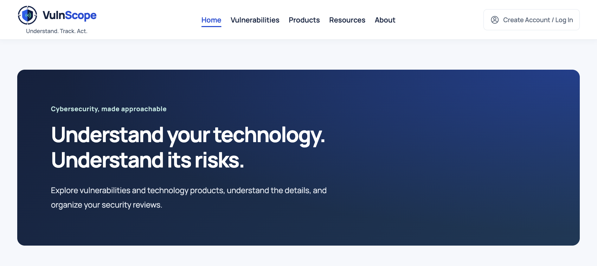

# VulnScope

**Understand, Track, and Act on Cybersecurity Vulnerabilities**

A full-stack cybersecurity awareness and review application created for
**CS 5610: Web Development** at Northeastern University.

VulnScope helps everyday technology users, cybersecurity students, and
security professionals explore publicly disclosed vulnerabilities and
organize locally managed security reviews.

- **Live Site:** [VulnScope](https://vulnscope-d4xk.onrender.com/)
- **Repository:** [jpaintsil-neu/vulnscope](https://github.com/jpaintsil-neu/vulnscope)
- **Progress Updated:** October 15, 2026

## Authors

### John Paintsil

- GitHub: [jpaintsil-neu](https://github.com/jpaintsil-neu)
- Responsibility: Vulnerability Awareness & Triage workspace.

### Sania Anwar

- Github: [saniaanwar] (https://github.com/saniaanwar)
- Responsibility: Product & Technology workspace.

**Course Page:** [CS 5610 — Web Development](https://johnguerra.co/classes/webDevelopment_online_fall_2026/)

## Project Objective

The goal is to build a useful, approachable application using semantic HTML,
modular CSS, vanilla JavaScript, Node.js, Express, and MongoDB.

The application has two planned independent feature areas:

- **Vulnerability Awareness & Triage:** Explore CVEs and manage local
  vulnerability records, review statuses, and analyst notes.
- **Product & Technology:** Explore technology products and manage local
  product-security records and review notes.

Each workspace must support its own CRUD workflow without depending on the
other workspace's collection. Imported NVD source data remains separate
from locally managed records.

The primary implementation focus is the **Homepage, Vulnerabilities, and
Products** pages. Supporting About and Resources pages provide
context and cybersecurity learning material.

The project also demonstrates:

- Client-side record rendering with vanilla JavaScript.
- ES modules in frontend and backend code.
- Node.js and Express API development.
- MongoDB operations using the native driver.
- Search, filtering, pagination, and record detail views.
- Semantic controls, responsive layouts, and accessible navigation.
- ESLint, Prettier, and Git/GitHub workflow.

**Current milestone:** VulnScope is publicly deployed on Render with
MongoDB Atlas containing **1,500 imported CVE records**. Hosted checks
passed for public CVE search, severity filtering, pagination, details,
and guest-workspace record creation, editing, persistence, and deletion.
Separate-browser guest isolation was also checked.

Local records support review-status filtering, and active filters are
preserved in the URL. Imported CVEs remain read-only. Products integration
and final submission deliverables remain pending.

## Pages

### Home — [`public/index.html`](./public/index.html)

The homepage introduces the platform and its two workspaces.

Implemented:

- Minimal navy gradient banner.
- Shared logo, navigation, sticky header, and footer.
- Working public vulnerability search by CVE ID or keyword.
- Search navigation to the Vulnerabilities page with the query applied.
- Overview of the vulnerability and product workspaces.

**Pending:** Product-specific search after Products integration.

### Vulnerabilities — [`public/vulnerabilities.html`](./public/vulnerabilities.html)

The workspace supports:

- Public CVE and My local records views.
- CVE ID, title, and description keyword search.
- Severity filtering.
- Results in pages of up to 20 records.
- Sticky column headings and top Previous/Next controls.
- Links to public and local record details.
- Loading, empty-result, error, and retry states.
- Add Vulnerability link to the local-record form.
- Local review-status filtering: New, In review, and Resolved.
- Active search, severity, and local review-status filters preserved in the URL.
- Filter-aware overview cards and charts.

### Products — Pending Integration

**Pending:** Product data import, MongoDB collection, APIs, search/filtering,
detail views, and local-record CRUD interface.

### Supporting Pages

- [About](./public/about.html) — Platform purpose, workflow, and data context.
- [Resources](./public/resources.html) — Cybersecurity learning resources.

See the [user guide](docs/user-guide.md) for page workflows.

## Original JavaScript Functionality

Vanilla JavaScript renders API results, switches collections, manages
filters and pagination, and handles local-record forms and actions.
Active filters are preserved in the URL.

See [architecture and module responsibilities](docs/architecture.md).

## Technologies

- HTML5 and CSS3.
- Vanilla JavaScript ES6+ and ES modules.
- CSS Grid and Flexbox.
- Fetch API.
- Node.js and npm.
- Express.
- MongoDB and the native MongoDB Node.js driver.
- Git and GitHub.
- ESLint and Prettier.

The implementation uses ES modules and the native database driver.
Mongoose and server-side template engines are excluded from the project.

## Project Structure

| Location   | Purpose                                                 |
| ---------- | ------------------------------------------------------- |
| `public/`  | HTML pages, CSS modules, browser JavaScript, and images |
| `src/`     | Express routes, database modules, models, and services  |
| `scripts/` | Database setup, NVD sample check, and data import       |
| `docs/`    | Detailed project documentation                          |

See the [complete folder/file mapping](docs/architecture.md#folder-and-file-mapping).

## Design Documentation

Personas, user stories, mockups, and responsibility split are documented in
the [design overview](docs/design.md).

The [shared mockup index](https://docs.google.com/spreadsheets/d/1OPhlHSFipS1TBg5fY3gODJUL3W921hsAR03a6K-po7k/edit)
includes the editable Figma reference. Final design-document review is pending.

## Installation and Local Development

Prerequisites: Node.js **24 LTS**, npm, a running MongoDB server or Atlas
connection, and internet access for the NVD import.

```bash
# Clone and install.
git clone https://github.com/jpaintsil-neu/vulnscope.git
cd vulnscope
npm ci
cp .env.example .env

# Prepare MongoDB and import CVEs.
node scripts/setup-database.js
node scripts/import-vulnerabilities.js

# Start the application.
npm run dev
```

For local MongoDB, the example configuration uses:

```dotenv
MONGODB_URI=mongodb://127.0.0.1:27017
MONGODB_DB_NAME=vulnscope
PORT=3000
```

For Atlas, edit `.env` with your own connection settings before running the scripts.
Open [http://localhost:3000](http://localhost:3000).
Use `npm start` for a regular server start.

See [detailed setup and troubleshooting](docs/setup.md).
Database records are imported separately and are not bundled with the repository.

## Using the Application

Search from Home, or open Vulnerabilities and choose Public CVEs or My local
records. Apply search/severity filters; local records also support review status.
Open a record for details, or use Add Vulnerability to create a local record.

Guest records belong to the browser workspace that created them.
Clearing its cookie removes access. Public CVEs remain read-only.

See the [user guide](docs/user-guide.md).

## API Endpoints

The Express API provides public CVE browsing and guest-owned local CRUD.
Local searches support `triageStatus` alongside search and severity.

See the [API reference](docs/api.md) for endpoints, validation, and examples.

**Pending:** Products endpoints.

## Public Data Sources

- [NIST NVD CVE API](https://nvd.nist.gov/developers/vulnerabilities) — implemented.
- [NIST NVD CPE/Product API](https://nvd.nist.gov/developers/products) — planned.

The development import is manual; the dataset reflects its last successful run.
See [import behavior](docs/setup.md#nvd-import).

## Code Quality

**Latest local checkpoint — October 14, 2026:** ESLint, Prettier formatting
verification, and Git whitespace checks passed.

**Pending:** Repeat checks after integrating remote updates and further
changes. Final unused-code review remains open.

### Run ESLint

```bash
npm run lint
```

### Format Files with Prettier

```bash
npm run format
```

### Verify Prettier Formatting

```bash
npm run format:check
```

Source modules include brief purpose comments and short documentation for
reusable functions.

## Validation

On October 14, 2026, all seven checked HTML source files and six rendered
Vulnerabilities views passed W3C Nu HTML Checker validation with zero
errors and zero warnings.

On October 15, hosted checks passed against the Render application and
MongoDB Atlas for public CVE browsing, search, severity filters, pagination,
details, guest-record CRUD, persistence, and separate-browser isolation.
The deployed vulnerability dataset contained 1,500 imported records.

See [validation results, corrections, and remaining checks](docs/validation.md)
for the detailed record and testing instructions.

**Pending:** Final accessibility/responsive review, additional rendered
states, and combined application testing after Products integration.
Repeat relevant checks after further changes.

## Accessibility

Implemented considerations include:

- Semantic HTML and standard interactive controls.
- Skip-to-content navigation.
- Visible keyboard focus.
- Decorative logo images with empty alternative text.
- Accessible mobile-menu state and Escape behavior.
- Keyboard-accessible table scrolling.
- Labeled search/filter controls.
- `aria-expanded`, `aria-controls`, and `aria-busy`.
- Status announcements for loading and errors.
- Responsive layout rules.

**Pending:** Final accessibility review across all completed pages and forms.

## Peer Code Review

**Pending — the Project 2 code-review requirement has not been completed.**

- Reviewed repository: [link]
- Review or pull-request: [link]
- Summary of findings and contributions.
- Validation performed.

## Screenshot

### Homepage



See [development screenshots](docs/dev.md) and [Figma design mockups](docs/mockup.md).

## Presentation and Demo Video

- **Google Slides Presentation:** [Project 2 — Presentation](https://docs.google.com/presentation/d/1VAJmpa_GvycCUX-Re0htSbg_81e-8JJs4MOuBCO9C20/edit?usp=drive_link) In-progress.
- **Short Public Narrated Demo Video:** Pending.
- **Published Demo Link:** Pending.

## Development Status

### In Progress / Next

- Products collection, data import, APIs, and full CRUD interface.
- Product-specific homepage search integration.
- Final design-document, usability, accessibility, and code-quality review.
- Deploy and validate Products after integration; the Vulnerabilities
  workflow is already live with 1,500 imported records.
- Screenshots, presentation, narrated video, and code review.
- Google Form submission and working thumbnail/links.
- Code freeze 24 hours before class; deployment, video, and slides before class.

## Generative AI Disclosure

### Tool and Model

- **Tool:** ChatGPT / Codex.
- **Provider:** OpenAI.
- **Model/version details:** Pending final documentation of the models used.

### How Generative AI Was Used

- John Paintsil - ChatGPT was used as an iterative development assistant by supporting tasks such as reviewing project requirements, organizing information architecture, and refining design documentation to enhance overall project quality and accessibility.

## License

This project is licensed under the **MIT License**.

See [`LICENSE`](./LICENSE) for details.
