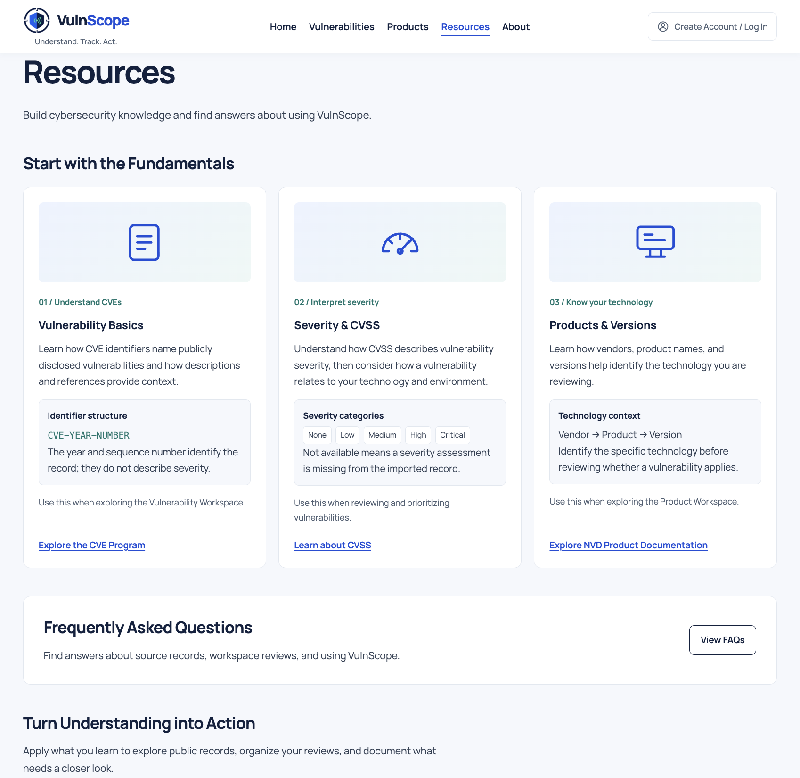

## Screenshot - Dev

These captures show the running application. Files are stored in
`public/images/screenshots/devs/`. Design mockups are documented separately
in [mockup.md](mockup.md).

### Homepage

### Vulnerabilities Workspace

Browse and search imported CVE records, filter vulnerabilities by severity and triage status, and review technical details alongside approachable explanations.

### Vulnerability - Create a Local Record

### Vulnerability - Update/Edit a Local Record

### Vulnerability - Delete a Local Record

### Products Workspace

**Pending:** Products screenshot after integration.

### Resources

### About

