## Screenshot - Dev

These captures show the running application. Files are stored in
`public/images/screenshots/devs/`. Design mockups are documented separately
in [mockup.md](mockup.md).

### Homepage

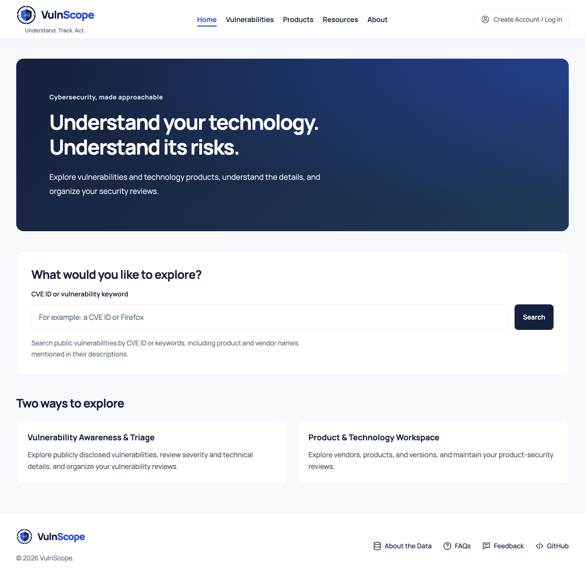

### Vulnerabilities Workspace

Browse and search imported CVE records, filter vulnerabilities by severity and triage status, and review technical details alongside approachable explanations.

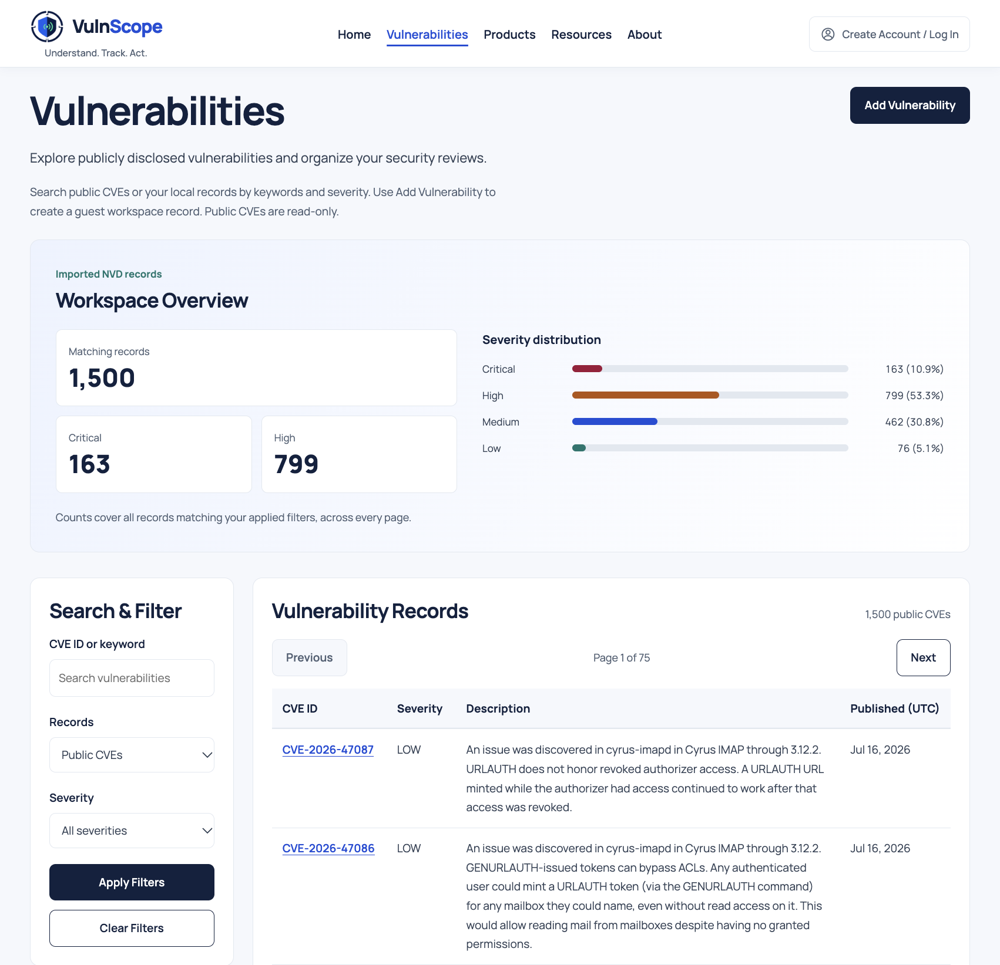

### Vulnerability - Create a Local Record

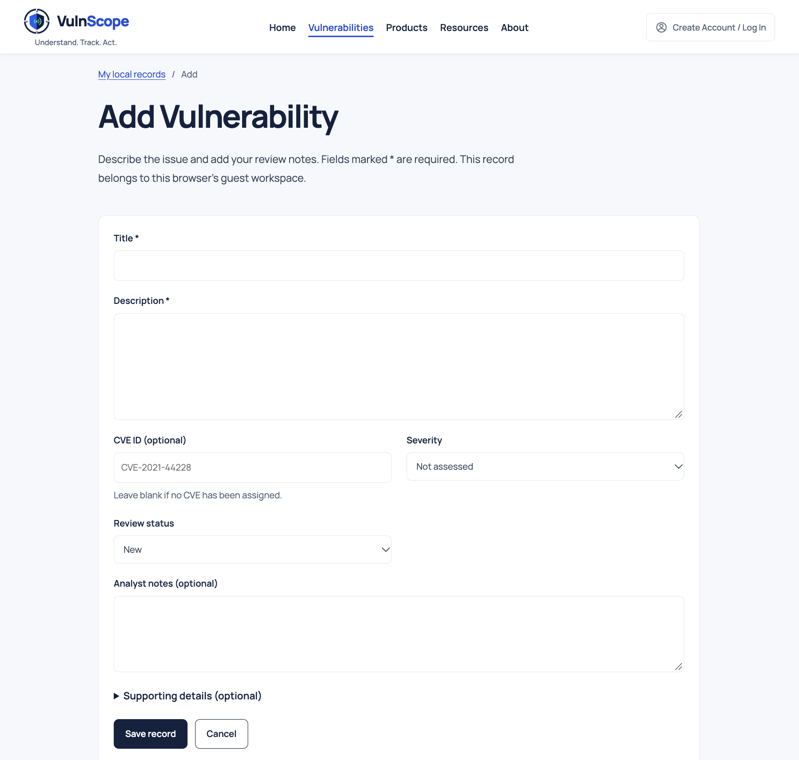

### Vulnerability - Update/Edit a Local Record

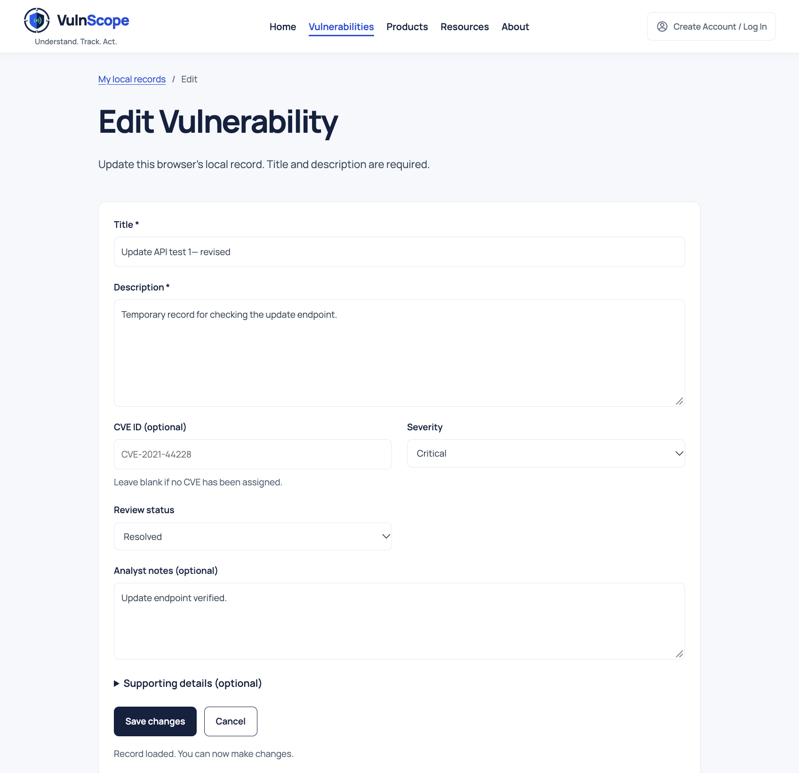

### Vulnerability - Delete a Local Record

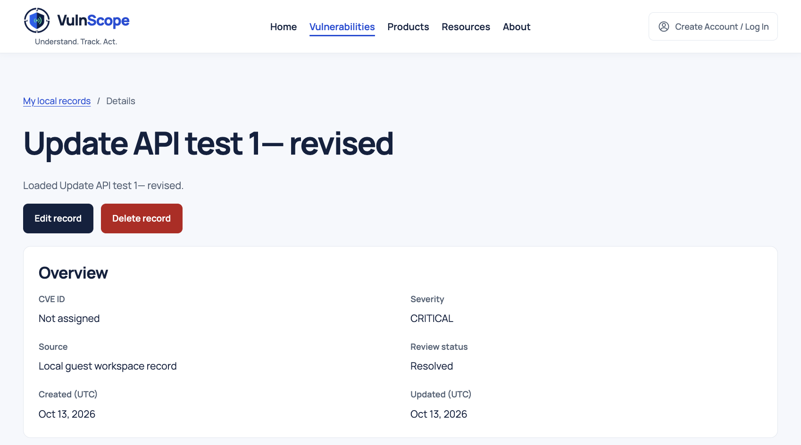
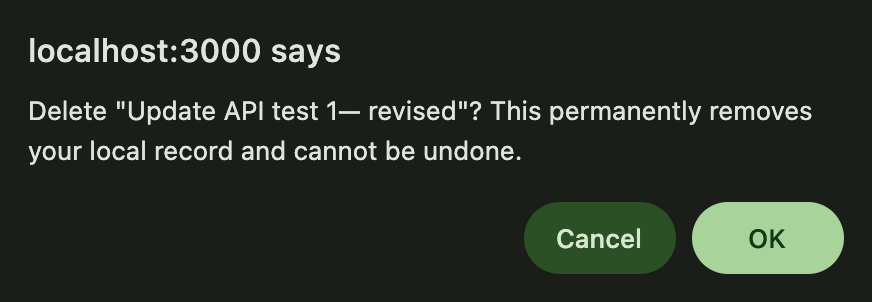

### Products Workspace

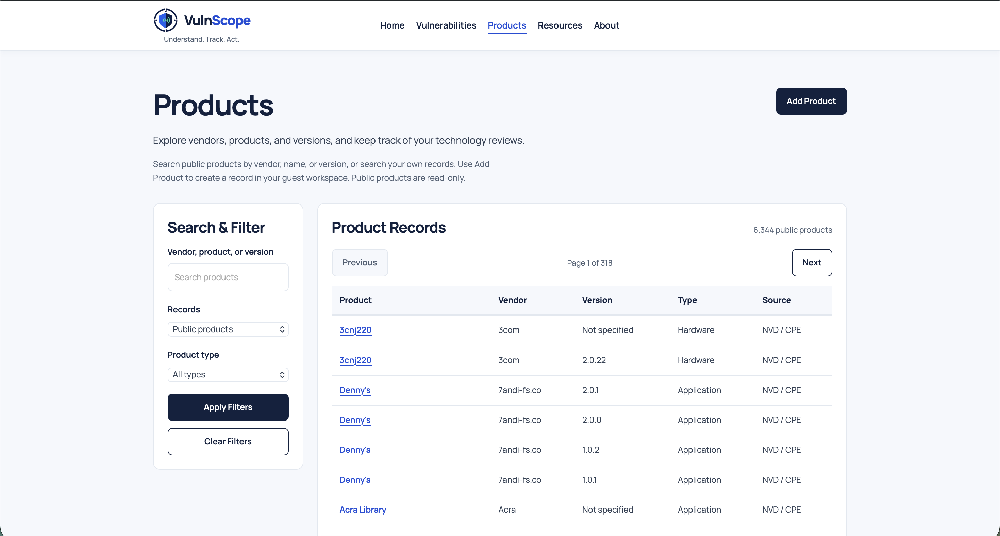

### Product Form

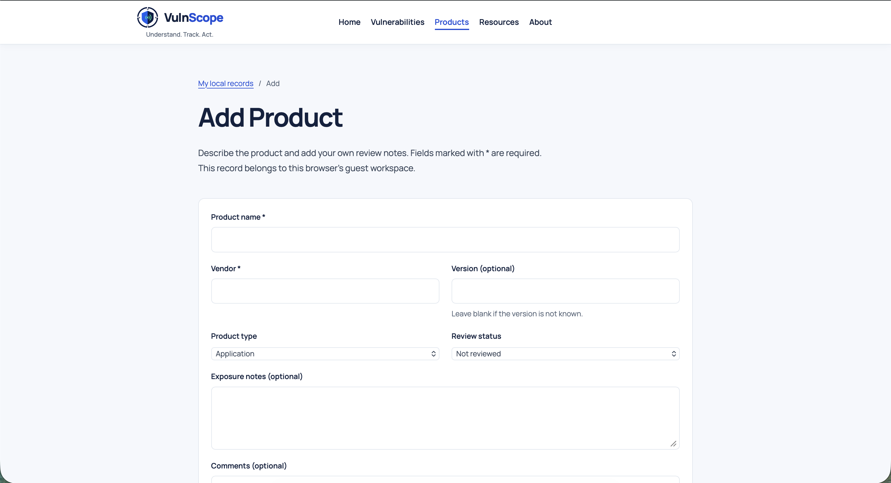

### Resources

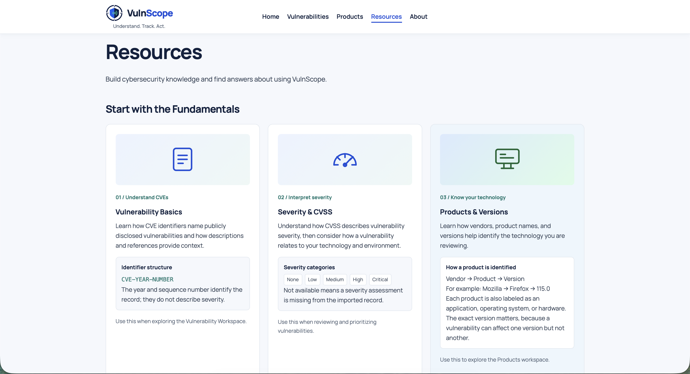

### About

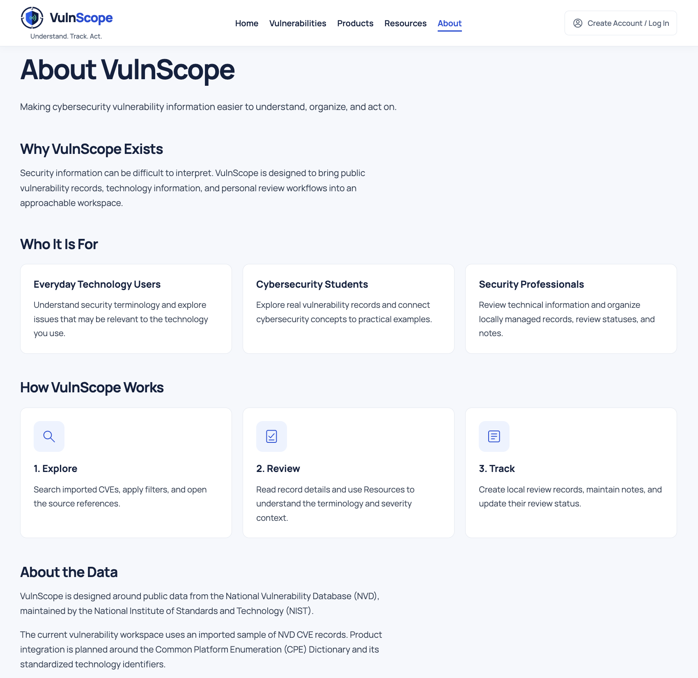

### Deployment Evidence

These screenshots were committed on October 15, 2026. They document the
displayed Render deployment and production cookie attributes. See
[validation status](validation.md) for the scope of the other reported checks.

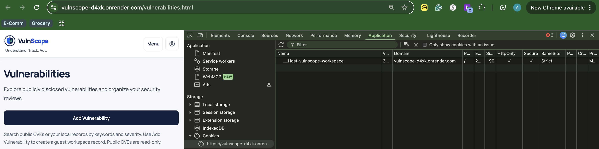
