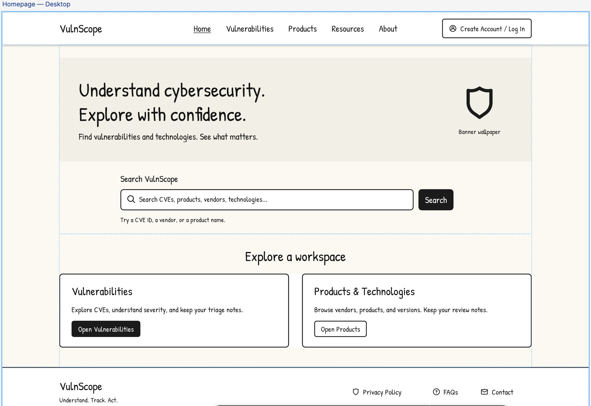
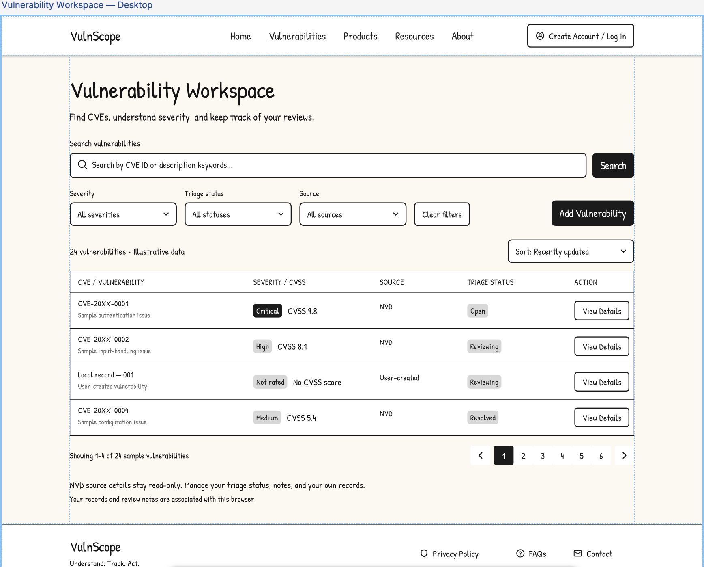
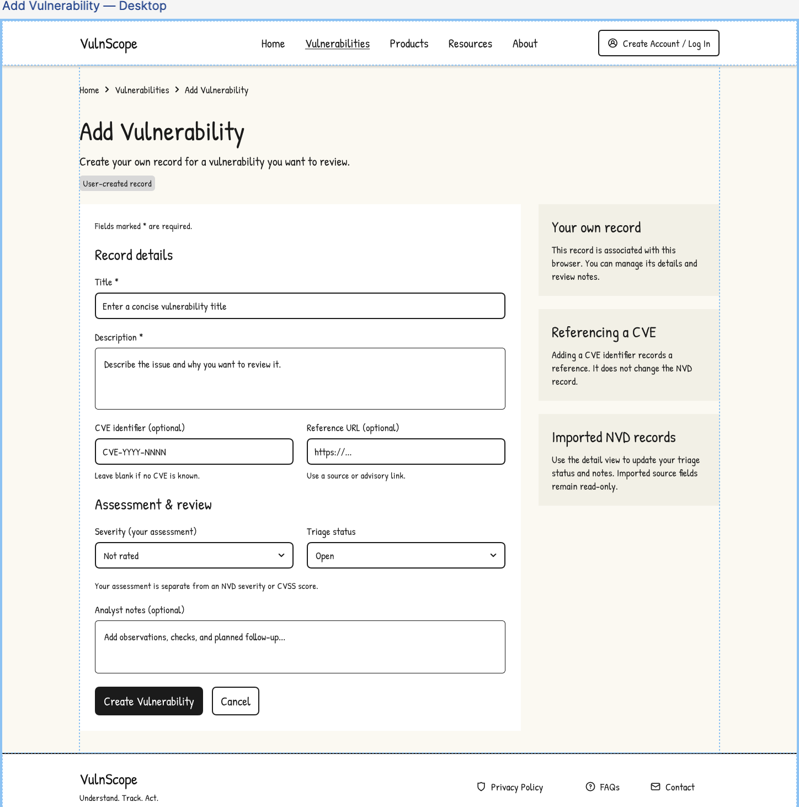
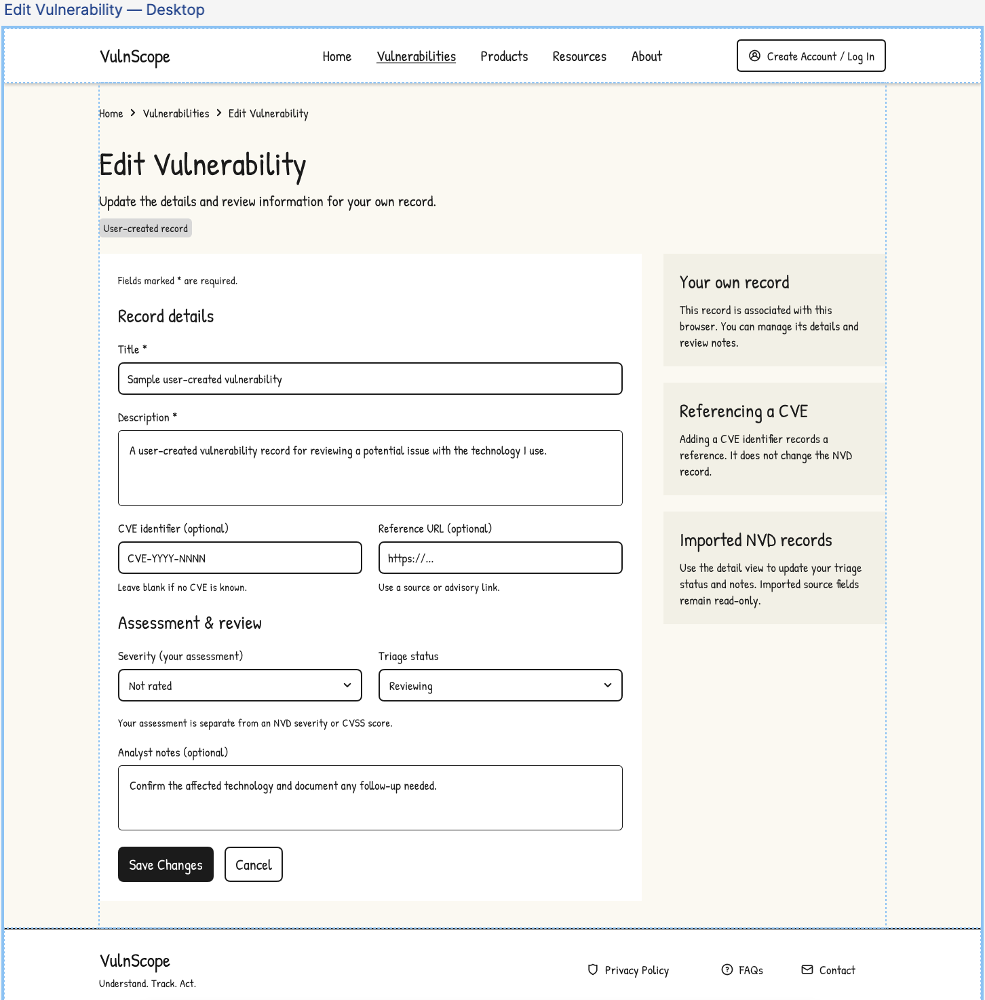
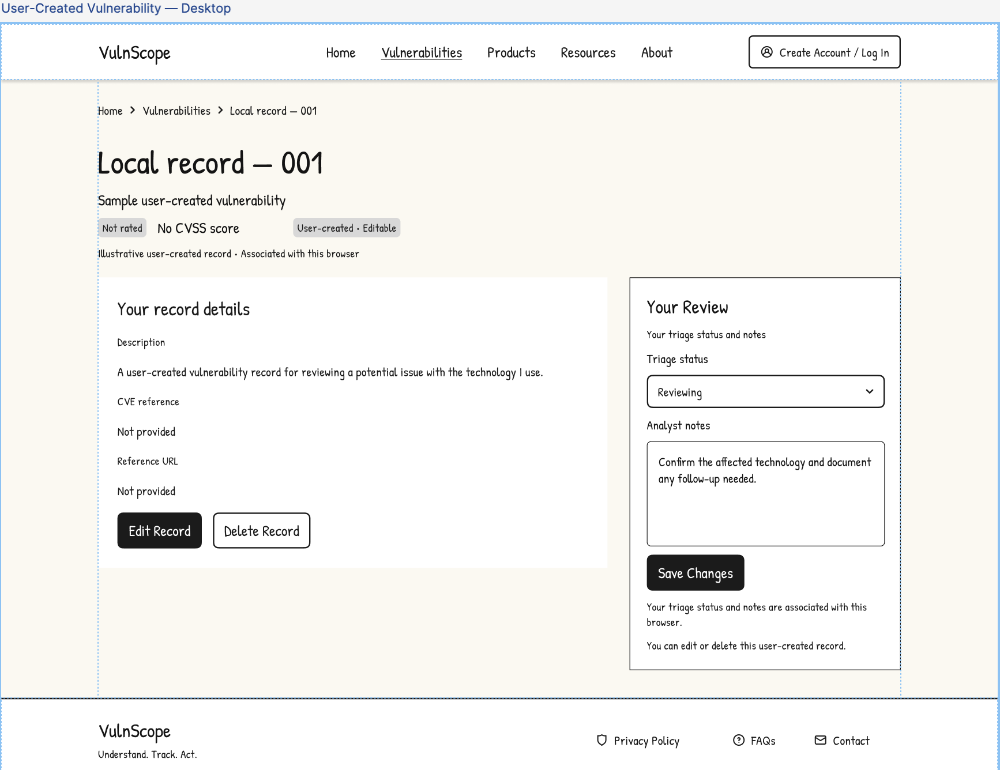
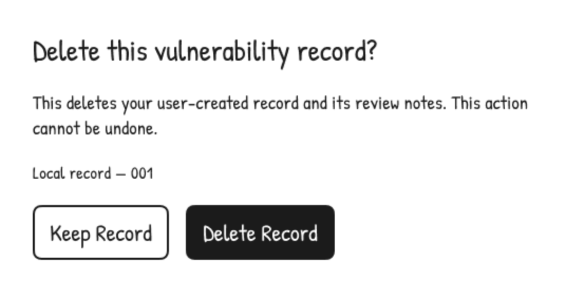
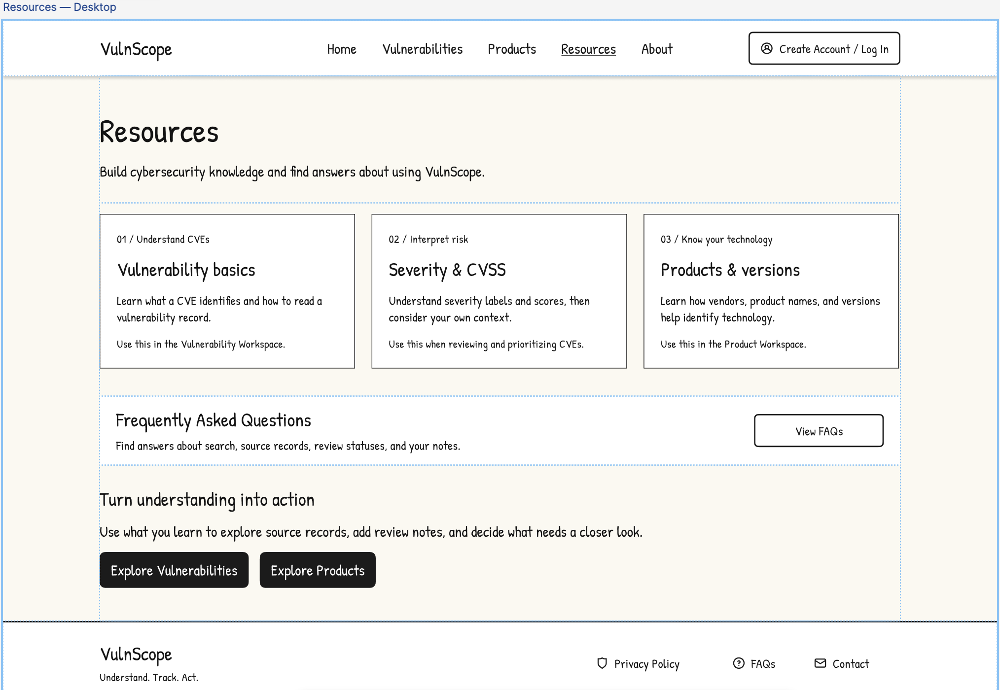
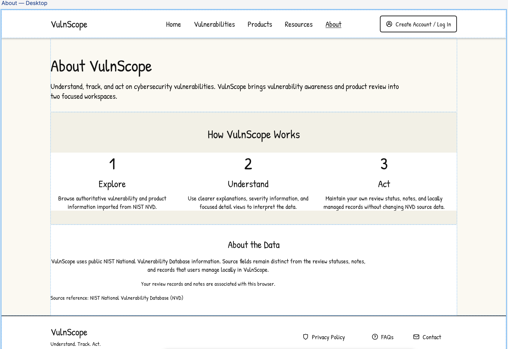

## Design Mockups

These exported Figma wireframes illustrate planned layouts and workflows.
Files are stored in `public/images/screenshots/mockups/`. They are separate
from [running-application screenshots](dev.md) and do not prove that a
feature has been implemented.

### Homepage

### Vulnerabilities Workspace

Browse and search imported CVE records, filter vulnerabilities by severity and triage status, and review technical details alongside approachable explanations.

### Vulnerability - Create a Local Record

### Vulnerability - Update a Local Record

### Vulnerability - Delete a Local Record

### Products Workspace

**Pending:** Products screenshot after integration.

### Resources

### About

